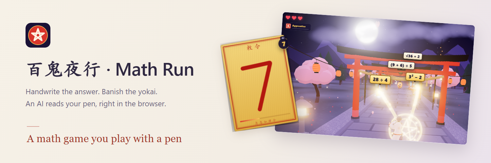
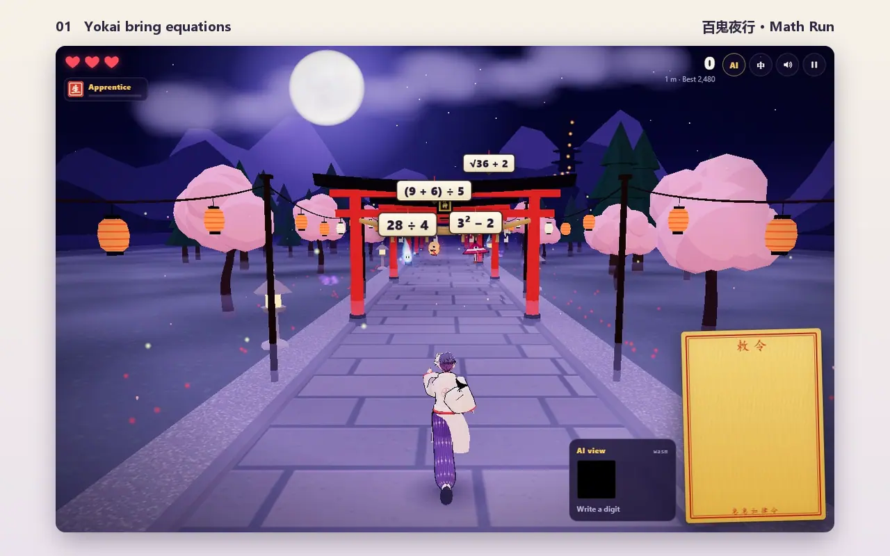
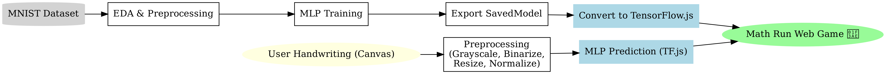
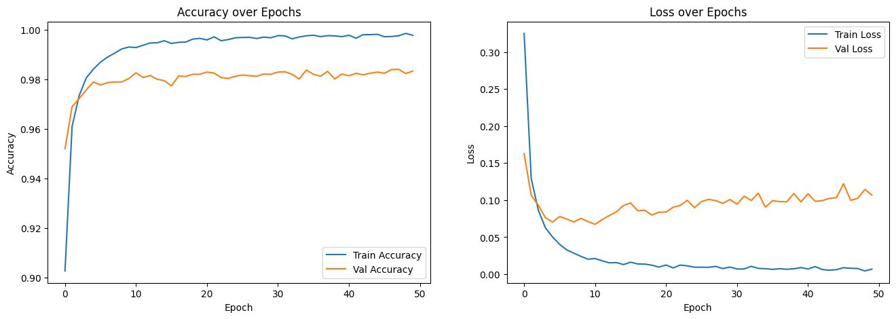
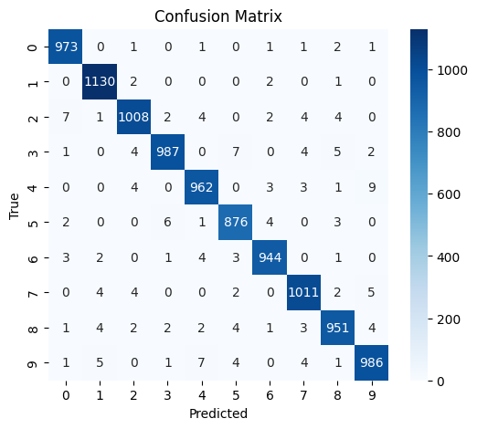
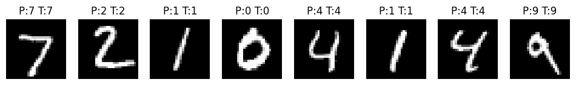

<p align="center">
  <picture>
    <source media="(prefers-color-scheme: dark)" srcset="docs/media/hero-dark.png">
    
  </picture>
</p>

<p align="center">
  <a href="https://alextianyf.github.io/Math-Run/"><picture><source media="(prefers-color-scheme: dark)" srcset="docs/media/badges/play-dark.svg"></picture></a>&nbsp;&nbsp;<a href="#quick-start-local-run"><picture><source media="(prefers-color-scheme: dark)" srcset="docs/media/badges/quick-start-dark.svg"></picture></a>
</p>

<p align="center">
  <picture><source media="(prefers-color-scheme: dark)" srcset="docs/media/badges/runs-in-dark.svg"></picture>&nbsp;&nbsp;<a href="LICENSE"><picture><source media="(prefers-color-scheme: dark)" srcset="docs/media/badges/free-dark.svg"></picture></a>
</p>

<p align="center">
  <sub>by <a href="https://github.com/alextianyf"><strong>Alex Tian</strong></a> &nbsp;·&nbsp; <a href="https://alextianyf.github.io/Math-Run/">Play online</a> &nbsp;·&nbsp; <a href="#how-to-play">How to play</a> &nbsp;·&nbsp; <a href="https://github.com/alextianyf/Math-Run/issues">Feedback</a> &nbsp;·&nbsp; <strong>English</strong> · <a href="README.zh-CN.md">简体中文</a></sub>
</p>

## Banish yokai with your handwriting

Yokai pour out of the night along a shrine path, each carrying a math problem. You are a young onmyōji: **handwrite the answer (0–9) on your talisman**, a neural network running in your browser reads it, and the talisman flies at **every** yokai whose answer matches.

Behind the scenes, a simple **MLP (Multi-Layer Perceptron)** that I trained on the classic **MNIST dataset** with **TensorFlow** recognizes your handwriting. It is deployed with **TensorFlow.js**, so it runs entirely on your device. Around it is a 3D game built with **Three.js** and an **adaptive difficulty system** that keeps every player challenged but not overwhelmed — no server, no build step, just static files on GitHub Pages.

[](docs/media/demo.png)

<p align="center"><sub>Recorded in the real game, in the browser: the 7 is written with the mouse and read by the model. <a href="docs/media/demo.png">View a still image</a>.</sub></p>

> The original 2D version (a runner 😎 escaping a monster 👹) is archived on the [`archive/v1-classic`](https://github.com/alextianyf/Math-Run/tree/archive/v1-classic) branch.

---

## Table of Contents

- [Banish yokai with your handwriting](#banish-yokai-with-your-handwriting)
- [How to Play](#how-to-play)
- [Highlights](#highlights)
- [FAQ](#faq)
- [Project Motivation](#project-motivation)
- [File Structure](#file-structure)
- [Quick Start (Local Run)](#quick-start-local-run)
- [Training Environment Setup (Python)](#training-environment-setup-python)
- [Tech Stack](#tech-stack)
- [Model Pipeline Workflow](#model-pipeline-workflow)
- [Model Performance](#model-performance)
- [Broader Impact \& Applications](#broader-impact--applications)
- [Future Improvements](#future-improvements)
- [Acknowledgments](#acknowledgments)
- [License](#license)

---

## How to Play

- Every yokai carries an equation. Its answer is always a single digit, 0–9.
- Write the answer on the talisman. When you lift the pen, the AI reads it.
- One talisman hits **every** yokai with that answer — spot the shared answers for bonus points.
- A yokai that reaches you costs a heart. Lose all three and the great oni catches you.
- Right answers raise your hidden **rating**. When it is high enough, a **rank-trial boss** appears; beat it to be promoted, from 阴阳生 *Apprentice* up to 晴明 *Seimei*. Each rank unlocks new kinds of problems.
- Every run started from the title opens with a short playable tutorial. Works with mouse, touch or pen, in Chinese or English.

---

## Highlights

### Handwriting recognition in the browser

- An MLP trained on MNIST (**98.28%** test accuracy), converted to TensorFlow.js and run on the **WASM** backend, which keeps the GPU free for the 3D scene.
- **My own preprocessing pipeline**, written without OpenCV: grayscale → Otsu threshold → crop → resize → centroid alignment (see [Model Pipeline Workflow](#model-pipeline-workflow)).
- **Context-aware decoding**: the model's probabilities are combined with the answers currently on screen. A sloppy 3 that looks a bit like an 8 still counts when a "3" yokai is present, while a clearly written wrong digit is a miss. The game-over card shows how often this corrected the model.
- A live guess while you write, and an **"AI view"** panel showing the 28×28 image the model actually sees and its top predictions.

### Adaptive difficulty

- **Procedural problems**: each one is built backwards from its answer (7 → 12 − 5 → 3 × 4 − 5 → √16 × 3 − 5), mixing + − × ÷, brackets, powers and roots. Every step is a whole number, so it can be solved in your head, and there is no fixed question bank to repeat.
- Every problem gets a **difficulty score on the same scale as the player's Elo-style rating**, so the game can simply ask for "a problem around 950".
- Problems are aimed at about **85% success**, following the "Eighty Five Percent Rule" for optimal learning ([Wilson et al., 2019, *Nature Communications*](https://www.nature.com/articles/s41467-019-12552-4)). After three right answers in a row comes a slightly harder *challenge* problem; after two wrong ones, an easier one.
- Difficulty climbs **smoothly** (only a small step per problem, however fast the rating moves), and **ranks unlock problem types**: × and ÷, then brackets, then squares and roots, then cubes and powers.
- **Pacing follows the player**: the time from pen down to the model's reading is measured, and yokai never arrive faster than the player can physically write.

### A 3D game that stays static

- **Three.js** with toon shading, outlines and bloom; a **VRM** character as the hero; every sound synthesized with the **Web Audio API** (no audio files).
- No backend, no API keys, **no build step**: libraries load from a CDN through an import map, so GitHub Pages hosts it for free.
- Smooth on modest PCs: every shader is compiled and every model uploaded while the page loads, and the graphics quality steps down automatically if frames get slow.

---

## FAQ

### What is Math Run?

A free 3D math game that runs in the browser. Yokai walk toward you carrying math problems; you handwrite each answer (a digit from 0 to 9) on a talisman, and a neural network reads your handwriting to banish them. [Play it here](https://alextianyf.github.io/Math-Run/).

### Do I need to install anything or create an account?

No. It is a static web page: open the link in any modern browser — on a computer, tablet or phone — and play with a mouse, finger or pen. Nothing is installed, and there is no sign-up.

### How does the game read my handwriting?

A small neural network (an MLP trained on the MNIST handwritten-digit dataset, 98.28% test accuracy) runs inside your browser with TensorFlow.js. Your strokes are turned into a 28×28 image, the model scores each digit, and the game combines those scores with the answers currently on screen, so a slightly messy digit still counts when it matches a yokai.

### Is my handwriting sent to a server?

No. Recognition happens entirely on your device; the game has no backend at all.

### How does the difficulty adapt?

The game keeps an Elo-style rating of your skill and generates each problem to match it, aiming for about 85% success — hard enough to stretch you, easy enough to stay in flow. Difficulty rises gradually, a challenge problem follows a streak, an easier one follows two misses, and the pace of the yokai follows how fast you actually write.

### What kinds of math problems are there?

Every answer is a whole number from 0 to 9, but the problems grow with your rank: addition and subtraction first, then multiplication and division, brackets and multi-step problems, squares and square roots, and finally cubes, powers and cube roots. They are generated on the fly, so they don't repeat.

### Who is it for?

Anyone who wants quick mental-math practice — students, parents and teachers looking for a playful drill, or developers curious about running machine learning in the browser. It is free for personal, educational and research use.

### Which languages are supported?

English and Simplified Chinese; switch with the 中 / EN button in the game.

---

## Project Motivation

The motivation behind **Math Run** was to combine my interests in deep learning and practical application deployment into one interactive project.

By training a simple neural network on the MNIST dataset and deploying it with TensorFlow.js, I wanted to demonstrate how deep learning models can move beyond research environments and power real-time applications directly in the browser.

This project showcases both the end-to-end deep learning workflow (data → training → deployment) and my ability to build engaging, interactive web application.

With **Night Parade**, the second version, I wanted to go further: wrap the model in a complete game, with a 3D world, a story and a difficulty system grounded in research on how people learn — while still running entirely in the browser.

---

## File Structure

This section provides a detailed overview of the project directory structure to help you understand where key files and resources are located.

```text
.
├── index.html                  # The page: HUD, talisman, title / pause / game-over screens
├── styles.css                  # All styling
├── js/
│   ├── main.js                 # Entry point: sets the stage, frame loop, buttons & keys
│   ├── game/                   # The rules of the game
│   │   ├── state.js            # Shared game state (S) and core numbers
│   │   ├── stage.js            # Shared 3D world, effects and difficulty director (+ shader prewarm)
│   │   ├── enemies.js          # Yokai: spawning, moving, equation tags
│   │   ├── handwriting.js      # Talisman pad → AI reading → decision
│   │   ├── combat.js           # Casting talismans, hits, misses, damage
│   │   ├── progress.js         # Score, hearts, waves, ranks, saved records
│   │   ├── tutorial.js         # The opening tutorial
│   │   ├── capture.js          # The "caught by the oni" cinematic
│   │   ├── flow.js             # Start / pause / game over / back to title
│   │   └── helpers.js          # Small shared helpers
│   ├── difficulty/             # Adaptive difficulty
│   │   ├── adaptive.js         # The director: Elo-style rating, pacing, ranks & unlocks
│   │   └── problems.js         # Procedural problem generator (answers are always 0–9)
│   ├── ai/                     # Handwritten-digit recognition (TensorFlow.js)
│   │   ├── recognizer.js       # Loads the model, classifies the talisman
│   │   ├── processing.js       # MNIST-style preprocessing pipeline
│   │   └── utils.js            # Image helpers (Otsu, connected components, centroid, blur…)
│   ├── scene/                  # 3D graphics (Three.js)
│   │   ├── world.js            # Renderer, bloom, lights, camera, auto quality
│   │   ├── environment.js      # The shrine path, torii, lanterns, trees, sky
│   │   ├── hero.js, heroRobe.js, heroStyle.js   # The VRM onmyōji and his robes
│   │   ├── yokai.js, oni.js    # The parade and the great oni
│   │   ├── fx.js               # Spell effects: particles, talismans, magic circles
│   │   └── toon.js, textures.js   # Toon materials, outlines, painted textures
│   └── ui/                     # Screen, text and sound
│       ├── ui.js               # HUD, equation tags, banners, AI panel, settings
│       ├── strings.js          # All texts, Chinese and English
│       ├── pad.js              # The talisman you write on
│       ├── coach.js            # The tutorial's spotlight and speech bubble
│       └── audio.js            # Synthesized sound effects and music
├── tests/                      # `npm test`: problem generator & difficulty checks (Node 18+)
├── docs/
│   ├── media/                  # README banner, badges and demo, link-preview card, training figures
│   └── demo/                   # Scripts that rebuild the README media from the real game
├── models/hero.vrm             # The hero's 3D model
├── mnist_tfjs_model/           # Deployed TensorFlow.js model (model.json + weights)
├── mlp_training/               # Python training notebook, logs, SavedModel
├── data/MNIST.zip              # Original MNIST dataset (for training)
├── requirements.txt            # Python dependencies (training)
└── LICENSE
```

---

## Quick Start (Local Run)

The game is plain static files — all it needs is a local web server:

```bash
git clone https://github.com/alextianyf/Math-Run.git
cd Math-Run
python -m http.server 8000
```

Then open `http://localhost:8000/` in your browser (recommended: Google Chrome). Any static server works; opening `index.html` straight from the file system does not, because browsers block JavaScript modules and model files on `file://`.

For development:

- `http://localhost:8000/?debug` — number keys cast directly (skipping the handwriting), and the game state is reachable from the console as `window.__mathrun`.
- `npm test` (Node.js 18+, nothing to install) — checks that every generated problem is correct and solvable, that each rank only gets the problem types it has unlocked, and that the difficulty keeps players near the success target.
- The banner, badges, demo animation and link-preview card are generated from the real game — see [docs/demo/README.md](docs/demo/README.md).

---

## Training Environment Setup (Python)

This is only needed to retrain the model in `mlp_training/` — the game itself runs without Python.

The `.venv` folder (local Python virtual environment) is **not** included in this repository.  

To set up the environment, please create your own virtual environment and install the required dependencies from `requirements.txt` as follows:

> Note: These instructions are for macOS. Setup may differ slightly on Windows.

---

### Recommended Configuration

- Operating System: MacOS(Windows and Linux environment are identical)

- Recommended Python Version: 3.12.4

- Integrated Development Environment: Visual Studio Code (VS Code)

- VS Code Extension: Jupyter Notebook(it's optional)

---

### 1. Creating Virtual Environment

Open your terminal in the project root directory and run:

```bash
python3 -m venv .venv
```

> It’s common practice to name the environment .venv. Most certainly, you could rename it accordingly.

To open a terminal in VS Code, use the shortcut: Ctrl + backtick (`)

---

### 2. Active the Virtual Environment(On Windows, the activation command may differ)

Run the following command in your terminal:

```bash
source .venv/bin/activate
```

---

### 3. Select the Python Interpreter in VS Code

Step 1: Press **`Cmd + Shift + P`** to open the Command Palette  

Step 2: Search for: **`Python: Select Interpreter`**  

Step 3: Choose the one that points to `./.venv`

---

### 4. Install `ipykernel` (Recommended Version: 6.29.5)

```bash
pip install ipykernel==6.29.5
```

> To verify or check your ipykernel installation version: `pip show ipykernel`

---

### 5. Install Project Dependencies

Install all required packages from the `requirements.txt`:

```bash
pip install -r requirements.txt
```

> You can modify or create your own environment by `pip freeze > requirements.txt`  
> you can use command `pip list` to list all installed packages

---

## Tech Stack

| Layer         | Technologies |
|---------------|--------------|
| **Game**      | HTML, CSS, JavaScript (ES modules, no build step), Three.js, three-vrm, Web Audio API |
| **In-browser AI** | TensorFlow.js (WASM backend) |
| **ML Training** | Python, TensorFlow/Keras, NumPy, Pandas |
| **Visualization** | Matplotlib, Seaborn |
| **Testing**   | Node.js (`npm test`) |
| **Deployment** | GitHub Pages (static files only) |

---

## Model Pipeline Workflow

The diagram below summarizes the workflow:

<div align="center">
  
</div>

The project consists of two major parts:

1. **Training Pipeline**
   - Load **MNIST dataset** (CSV from ZIP).  
   - Perform quick **EDA**: shapes, label distribution, pixel range, sample visualization.  
   - Normalize pixel values to [0,1] and **one-hot encode** labels.  
   - Split data into **train / validation / test** sets.  
   - Build a simple **MLP**:  
     - Dense(512, ReLU) + Dropout(0.2)  
     - Dense(64, ReLU)  
     - Dense(10, Softmax)  
   - Train with **tf.GradientTape** over 50 epochs, log metrics to TensorBoard.  
   - Evaluate on test set with **confusion matrix** and **classification report**.  
   - Export model as TensorFlow `SavedModel` and convert to **TensorFlow.js** for web deployment.  

2. **Inference Pipeline** (`js/ai/` and `js/game/handwriting.js`)
   - Capture handwriting on the talisman (mouse, touch or pen). The pad waits a moment after the pen lifts — longer for a mouse — so digits drawn in several strokes, like 4, aren't read half-written.
   - Apply preprocessing steps:
     - Convert RGBA → grayscale
     - Otsu thresholding (binarization, adaptive inversion)
     - Crop to the bounding box of all strokes (a largest-connected-component mode is also implemented)
     - Resize longest side to 20px, paste into 28×28 canvas
     - Align digit to centroid
     - (Optional) Gaussian blur
     - Normalize to [0,1]
   - Feed the 28×28 image into the deployed **MLP (TensorFlow.js)** model.
   - Obtain digit prediction (softmax probabilities).
   - Decide in context, using the answers currently on screen:
     - **Hit** → a talisman flies at every yokai with that answer
     - **Miss** (a clearly written digit no yokai has) → the talisman fizzles and counts as a wrong answer
     - **Unclear** → the player is asked to write again

---

## Model Performance

The trained MLP model achieved high performance on the MNIST dataset:

- **Final Training Accuracy**: ~99.8%  
- **Final Validation Accuracy**: ~98.3%  
- **Test Accuracy**: **98.28%**  
- **Test Loss**: 0.0949

### Classification Report

| Digit | Precision | Recall | F1-Score | Support |
|-------|-----------|--------|----------|---------|
| 0 | 0.985 | 0.993 | 0.989 | 980 |
| 1 | 0.986 | 0.996 | 0.991 | 1135 |
| 2 | 0.983 | 0.977 | 0.980 | 1032 |
| 3 | 0.988 | 0.977 | 0.983 | 1010 |
| 4 | 0.981 | 0.980 | 0.980 | 982 |
| 5 | 0.978 | 0.982 | 0.980 | 892 |
| 6 | 0.986 | 0.985 | 0.986 | 958 |
| 7 | 0.982 | 0.984 | 0.983 | 1028 |
| 8 | 0.979 | 0.976 | 0.978 | 974 |
| 9 | 0.979 | 0.977 | 0.978 | 1009 |

- **Macro Avg**: Precision 0.983, Recall 0.983, F1-Score 0.983  
- **Weighted Avg**: Precision 0.983, Recall 0.983, F1-Score 0.983  

### Training Curves

<div align="center">
  
</div>

### Confusion Matrix

<div align="center">
  
</div>

### Sample Predictions

<div align="center">
  
</div>

The model shows consistent performance across all digit classes with minimal misclassification.

---

## Broader Impact & Applications

Although **Math Run** is presented as a playful demo, the underlying concepts are highly transferable and can be applied across industries:

- **Handwriting & Character Recognition**  
  - The digit recognition pipeline can be extended to recognize letters, signatures, or symbols.  
  - Applications include document digitization, form processing, and handwriting-based authentication.  

- **Human-Computer Interaction (HCI)**  
  - The browser-based drawing pad shows how web interfaces can integrate with deep learning models in real-time.  
  - Similar pipelines can be adapted for sketch-based search engines, educational tools, or accessibility solutions.  

- **Gamification in Education & Training**  
  - Combining interactive gameplay with ML showcases how gamification can enhance learning.  
  - The adaptive director shows how a simple learner model (an Elo-style rating) and research on optimal challenge can keep practice in the sweet spot — not too easy, not too hard.
  - Similar methods could be used to teach math, language, or even industrial training scenarios.  

- **Edge & Browser-Based AI**  
  - By deploying models with TensorFlow.js, this project highlights how inference can happen entirely on-device, without backend servers.  
  - This idea is transferable to privacy-sensitive applications such as healthcare diagnostics, financial services, or personal assistants.  

In short, while **Math Run** is a simple demo, the techniques behind it—data preprocessing, model training, browser deployment, and real-time interaction—form a foundation that can be adapted to many exciting domains.

---

## Future Improvements

While **Math Run** already shows a neural network working inside a complete game, there are several directions it could grow:

1. **Multi-digit Answers**
   - Recognize a sequence of digits (by splitting the strokes, or with a sequence model), so answers can go beyond 9.

2. **Model Enhancements**
   - Experiment with CNNs (Convolutional Neural Networks) for better accuracy on hurried handwriting.
   - Explore quantization to deploy a lighter and faster model.

3. **Personalization**
   - Fine-tune the model on the player's own handwriting, right in the browser (TensorFlow.js can train on-device).

4. **Leaderboards**
   - Share scores and ranks with other players — this would need a small backend, which the project deliberately avoids so far.

---

## Acknowledgments

- The **MNIST dataset**: a classic benchmark dataset of handwritten digits, which has enabled decades of progress in computer vision research.  

- **TensorFlow.js**: for providing the tools to run deep learning models directly in the browser, making this interactive demo possible.  
- **Three.js**: the 3D engine behind the shrine path, the yokai and the spell effects.
- **Wilson et al. (2019)**, *The Eighty Five Percent Rule for optimal learning*: the success rate the adaptive difficulty aims for.
- **VRoid Project / pixiv**: the hero is the CC0 VRoid Studio sample character "Sakurada Fumiriya" (`models/hero.vrm`, restyled in-game), rendered with [three-vrm](https://github.com/pixiv/three-vrm).  

- The open-source community: whose libraries, documentation, and shared knowledge make projects like this achievable.  

---

## License

This project is released under a custom license:

- The **MNIST dataset** used in this project is publicly available and free to use for research and educational purposes (Yann LeCun et al.).  
- All **code, game logic, and assets** in this repository were independently created by **Alex Tian**, except the hero's base 3D model (CC0, credited in Acknowledgments).  
- You are free to use, copy, or modify the code **for personal, research, or educational purposes only**.  
- **Commercial use is strictly prohibited** without prior written permission from the author.  

THE SOFTWARE IS PROVIDED "AS IS", WITHOUT WARRANTY OF ANY KIND, EXPRESS OR IMPLIED.