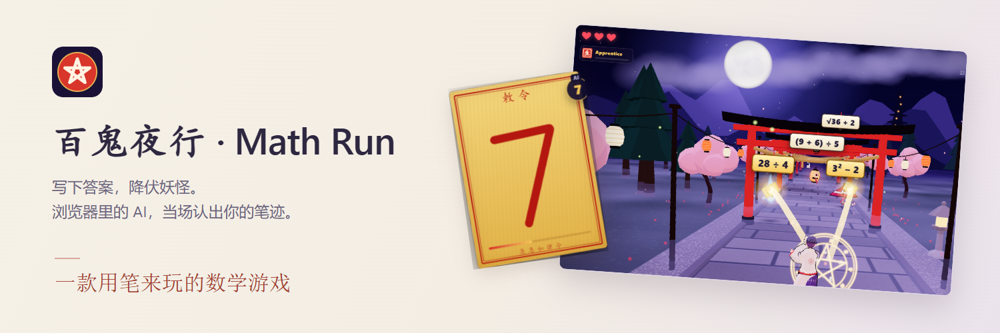

<p align="center">
  <picture>
    <source media="(prefers-color-scheme: dark)" srcset="docs/media/hero-zh-dark.png">
    
  </picture>
</p>

<p align="center">
  <a href="https://alextianyf.github.io/Math-Run/"><picture><source media="(prefers-color-scheme: dark)" srcset="docs/media/badges/play-zh-dark.svg"></picture></a>&nbsp;&nbsp;<a href="#快速开始本地运行"><picture><source media="(prefers-color-scheme: dark)" srcset="docs/media/badges/quick-start-zh-dark.svg"></picture></a>
</p>

<p align="center">
  <picture><source media="(prefers-color-scheme: dark)" srcset="docs/media/badges/runs-in-zh-dark.svg"></picture>&nbsp;&nbsp;<a href="LICENSE"><picture><source media="(prefers-color-scheme: dark)" srcset="docs/media/badges/free-zh-dark.svg"></picture></a>
</p>

<p align="center">
  <sub>作者 <a href="https://github.com/alextianyf"><strong>Alex Tian</strong></a> &nbsp;·&nbsp; <a href="https://alextianyf.github.io/Math-Run/">在线试玩</a> &nbsp;·&nbsp; <a href="#怎么玩">怎么玩</a> &nbsp;·&nbsp; <a href="https://github.com/alextianyf/Math-Run/issues">反馈</a> &nbsp;·&nbsp; <a href="README.md">English</a> · <strong>简体中文</strong></sub>
</p>

## 用笔迹降伏百鬼

夜色中，妖怪们沿着神社参道涌来，每只头上都顶着一道算式。你是一位少年阴阳师：**在符纸上手写答案（0–9）**，浏览器里的神经网络当场认出你的字，符纸便会飞向**所有**答案相同的妖怪。

背后识别手写的，是我用 **TensorFlow** 在经典的 **MNIST 手写数字数据集**上训练的一个简单 **MLP（多层感知机）**。模型通过 **TensorFlow.js** 部署，完全在你的设备上运行。围绕它的是用 **Three.js** 搭建的 3D 游戏，以及一套**自适应难度系统**，让每位玩家都有挑战、又不至于被压垮——没有服务器，不需要构建，只是 GitHub Pages 上的一组静态文件。

[](docs/media/demo.png)

<p align="center"><sub>在真实游戏中录制：7 是用鼠标写的，由模型识别。<a href="docs/media/demo.png">查看静态图</a>。</sub></p>

> 最初的 2D 版本（😎 跑者躲避 👹 怪物）存档在 [`archive/v1-classic`](https://github.com/alextianyf/Math-Run/tree/archive/v1-classic) 分支。

---

## 目录

- [用笔迹降伏百鬼](#用笔迹降伏百鬼)
- [怎么玩](#怎么玩)
- [亮点](#亮点)
- [常见问题](#常见问题)
- [项目动机](#项目动机)
- [文件结构](#文件结构)
- [快速开始（本地运行）](#快速开始本地运行)
- [训练环境配置（Python）](#训练环境配置python)
- [技术栈](#技术栈)
- [模型流程](#模型流程)
- [模型表现](#模型表现)
- [更广泛的影响与应用](#更广泛的影响与应用)
- [未来改进](#未来改进)
- [致谢](#致谢)
- [许可证](#许可证)

---

## 怎么玩

- 每只妖怪都带着一道算式，答案永远是一位数，0–9。
- 在符纸上写下答案，抬笔后 AI 就会读出来。
- 一张符会打中**所有**答案相同的妖怪——找出共同答案能拿额外分数。
- 妖怪走到你面前会扣一颗心；三颗心都没了，大鬼就会把你抓走。
- 答对会提升你隐藏的**实力分**。分数够高时会出现**晋升考核大鬼**，打败它就能晋升：从阴阳生一路升到晴明，每一阶都会解锁新的题型。
- 每次从首页开始，都会先进入一段可以边玩边学的简短教程。支持鼠标、手指和触控笔，可在中文和英文之间切换。

---

## 亮点

### 浏览器里的手写识别

- 在 MNIST 上训练的 MLP（测试准确率 **98.28%**），转换为 TensorFlow.js，运行在 **WASM** 后端上，把显卡留给 3D 画面。
- **我自己写的预处理流程**，没有用 OpenCV：灰度 → Otsu 阈值 → 裁剪 → 缩放 → 质心对齐（见[模型流程](#模型流程)）。
- **结合上下文的识别**：模型给出的概率会和屏幕上现有的答案结合判断。写得有点潦草、像 8 的 3，只要场上有答案是 3 的妖怪，照样算对；而清楚写出的错误数字就算写错。结算页会显示这种"纠正"发生了几次。
- 写字时实时显示猜测，"AI 视图"面板会展示模型实际看到的 28×28 图像和它最有把握的几个答案。

### 自适应难度

- **程序生成题目**：每道题都从答案倒推出来（7 → 12 − 5 → 3 × 4 − 5 → √16 × 3 − 5），混合加减乘除、括号、乘方和开方。每一步都是整数，可以心算，也没有固定题库，不会重复。
- 每道题都有一个**难度分，和玩家的 Elo 式实力分在同一尺度上**，所以游戏可以直接要"一道 950 分左右的题"。
- 题目瞄准约 **85% 的正确率**，依据是学习研究中的"85% 法则"（[Wilson et al., 2019, *Nature Communications*](https://www.nature.com/articles/s41467-019-12552-4)）。连对三题后会来一道稍难的*挑战题*，连错两题后会来一道简单些的。
- 难度**平滑上升**（不管实力分涨得多快，每题只升一小步），而且**阶位解锁题型**：先是乘除，再是括号，然后是平方与开方，最后是立方与乘方。
- **节奏跟随玩家**：游戏会测量从落笔到模型读出的时间，妖怪出现的速度永远不会快过你实际写字的速度。

### 纯静态的 3D 游戏

- **Three.js** 卡通渲染、描边和泛光；主角是一个 **VRM** 角色；所有音效都由 **Web Audio API** 实时合成（没有音频文件）。
- 没有后端、没有 API 密钥、**不需要构建**：库通过 import map 从 CDN 加载，GitHub Pages 就能免费托管。
- 普通电脑也流畅：所有着色器和模型都在加载界面期间预先准备好，画面变慢时会自动降低画质。

---

## 常见问题

### Math Run 是什么？

一款在浏览器里运行的免费 3D 数学游戏。妖怪带着数学题向你走来，你把答案（0 到 9 的一个数字）手写在符纸上，神经网络认出你的字，就能降伏它们。[点这里试玩](https://alextianyf.github.io/Math-Run/)。

### 需要安装什么或注册账号吗？

不需要。它就是一个静态网页：用任何现代浏览器打开链接即可，电脑、平板、手机都行，鼠标、手指、触控笔都能写。不用安装，也不用注册。

### 游戏怎么认出我的手写？

一个小型神经网络（在 MNIST 手写数字数据集上训练的 MLP，测试准确率 98.28%）通过 TensorFlow.js 在你的浏览器里运行。你的笔画会被转成一张 28×28 的图像，模型给每个数字打分，游戏再把这些分数和屏幕上现有的答案结合起来，所以字写得稍微潦草一点，只要对得上某只妖怪，照样算对。

### 我的手写会被上传到服务器吗？

不会。识别完全在你的设备上进行，这个游戏根本没有后端。

### 难度是怎么自适应的？

游戏会为你的水平维护一个 Elo 式的实力分，并按这个分数生成每一道题，目标是大约 85% 的正确率——既有挑战，又能保持心流。难度逐步上升，连对之后会来一道挑战题，连错两题后会来一道简单些的题，妖怪的节奏也会跟着你实际写字的速度走。

### 有哪些数学题？

答案都是 0 到 9 的整数，但题目会随阶位升级：先是加减法，然后是乘除法、括号和多步运算、平方与开平方，最后是立方、乘方与开立方。题目都是实时生成的，不会重复。

### 适合谁玩？

任何想练练心算的人——想找有趣练习的学生、家长和老师，或者好奇如何在浏览器里运行机器学习的开发者。个人、教育和研究用途均免费。

### 支持哪些语言？

英文和简体中文，在游戏里点 中 / EN 按钮切换。

---

## 项目动机

做 **Math Run** 的初衷，是把我对深度学习和实际应用部署的兴趣结合到一个可以互动的项目里。

通过在 MNIST 上训练一个简单的神经网络，再用 TensorFlow.js 部署，我想展示深度学习模型可以走出研究环境，直接在浏览器里驱动实时应用。

这个项目既展示了端到端的深度学习流程（数据 → 训练 → 部署），也展示了我构建有趣、可互动的网页应用的能力。

在第二版**百鬼夜行**里，我想再往前走一步：把模型包装进一个完整的游戏——有 3D 世界、有故事，还有一套以学习研究为依据的难度系统——同时依然完全在浏览器里运行。

---

## 文件结构

```text
.
├── index.html                  # 页面：HUD、符纸、首页 / 暂停 / 结算界面
├── styles.css                  # 所有样式
├── js/
│   ├── main.js                 # 入口：搭建场景、每帧循环、按钮和按键
│   ├── game/                   # 游戏规则
│   │   ├── state.js            # 共享的游戏状态（S）和核心数值
│   │   ├── stage.js            # 共享的 3D 世界、特效和难度控制器（含着色器预热）
│   │   ├── enemies.js          # 妖怪：生成、移动、算式牌
│   │   ├── handwriting.js      # 符纸手写 → AI 识别 → 判断
│   │   ├── combat.js           # 出符、命中、写错、受伤
│   │   ├── progress.js         # 分数、生命、波次、阶位、存档纪录
│   │   ├── tutorial.js         # 开场教程
│   │   ├── capture.js          # "被大鬼抓住"的过场动画
│   │   ├── flow.js             # 开始 / 暂停 / 结算 / 回到首页
│   │   └── helpers.js          # 共用的小工具函数
│   ├── difficulty/             # 自适应难度
│   │   ├── adaptive.js         # 难度控制器：Elo 式实力分、节奏、阶位与解锁
│   │   └── problems.js         # 程序出题器（答案永远是 0–9）
│   ├── ai/                     # 手写数字识别（TensorFlow.js）
│   │   ├── recognizer.js       # 加载模型、识别符纸
│   │   ├── processing.js       # MNIST 风格的预处理流程
│   │   └── utils.js            # 图像工具（Otsu、连通域、质心、模糊……）
│   ├── scene/                  # 3D 画面（Three.js）
│   │   ├── world.js            # 渲染器、泛光、灯光、镜头、自动画质
│   │   ├── environment.js      # 神社参道、鸟居、灯笼、树木、夜空
│   │   ├── hero.js, heroRobe.js, heroStyle.js   # VRM 少年阴阳师和他的狩衣
│   │   ├── yokai.js, oni.js    # 百鬼夜行和大鬼
│   │   ├── fx.js               # 法术特效：粒子、符纸、法阵
│   │   └── toon.js, textures.js   # 卡通材质、描边、手绘贴图
│   └── ui/                     # 界面、文字和声音
│       ├── ui.js               # HUD、算式牌、横幅、AI 面板、设置
│       ├── strings.js          # 全部中英文文本
│       ├── pad.js              # 用来写字的符纸
│       ├── coach.js            # 教程的聚光灯和对话框
│       └── audio.js            # 合成的音效和音乐
├── tests/                      # `npm test`：出题器与难度检查（Node 18+）
├── docs/
│   ├── media/                  # README 横幅、徽章、演示动图、分享卡片、训练图表
│   └── demo/                   # 从真实游戏重新生成 README 素材的脚本
├── models/hero.vrm             # 主角的 3D 模型
├── mnist_tfjs_model/           # 部署用的 TensorFlow.js 模型（model.json + 权重）
├── mlp_training/               # Python 训练笔记本、日志、SavedModel
├── data/MNIST.zip              # 原始 MNIST 数据集（训练用）
├── requirements.txt            # Python 依赖（训练用）
└── LICENSE
```

---

## 快速开始（本地运行）

游戏就是一组静态文件，只需要一个本地网页服务器：

```bash
git clone https://github.com/alextianyf/Math-Run.git
cd Math-Run
python -m http.server 8000
```

然后在浏览器里打开 `http://localhost:8000/`（推荐 Google Chrome）。任何静态服务器都可以；但直接双击打开 `index.html` 不行，因为浏览器会在 `file://` 下拦截 JavaScript 模块和模型文件。

开发时：

- `http://localhost:8000/?debug` —— 数字键直接出符（跳过手写），游戏状态可以在控制台通过 `window.__mathrun` 访问。
- `npm test`（Node.js 18+，无需安装任何东西）—— 检查每道生成的题都正确、可心算，每个阶位只会出它已解锁的题型，难度能让玩家保持在目标正确率附近。
- 横幅、徽章、演示动图和分享卡片都是从真实游戏生成的，见 [docs/demo/README.md](docs/demo/README.md)。

---

## 训练环境配置（Python）

只有重新训练 `mlp_training/` 里的模型时才需要；游戏本身不需要 Python。

仓库里**不**包含 `.venv` 文件夹（本地 Python 虚拟环境）。请按下面的步骤自己创建虚拟环境，并从 `requirements.txt` 安装依赖：

> 注意：以下步骤以 macOS 为例，Windows 上可能略有不同。

### 推荐配置

- 操作系统：macOS（Windows 和 Linux 基本相同）
- 推荐 Python 版本：3.12.4
- 开发工具：Visual Studio Code（VS Code）
- VS Code 扩展：Jupyter Notebook（可选）

### 1. 创建虚拟环境

在项目根目录打开终端，运行：

```bash
python3 -m venv .venv
```

> 通常把环境命名为 .venv，你也可以换成别的名字。在 VS Code 里打开终端的快捷键是 Ctrl + 反引号（`）。

### 2. 激活虚拟环境（Windows 上的命令可能不同）

```bash
source .venv/bin/activate
```

### 3. 在 VS Code 里选择 Python 解释器

第 1 步：按 **`Cmd + Shift + P`** 打开命令面板

第 2 步：搜索 **`Python: Select Interpreter`**

第 3 步：选择指向 `./.venv` 的那一个

### 4. 安装 `ipykernel`（推荐版本 6.29.5）

```bash
pip install ipykernel==6.29.5
```

> 用 `pip show ipykernel` 查看已安装的版本。

### 5. 安装项目依赖

```bash
pip install -r requirements.txt
```

> 可以用 `pip freeze > requirements.txt` 导出自己的环境，用 `pip list` 列出所有已安装的包。

---

## 技术栈

| 层级 | 技术 |
|------|------|
| **游戏** | HTML、CSS、JavaScript（ES 模块，无需构建）、Three.js、three-vrm、Web Audio API |
| **浏览器端 AI** | TensorFlow.js（WASM 后端） |
| **模型训练** | Python、TensorFlow/Keras、NumPy、Pandas |
| **可视化** | Matplotlib、Seaborn |
| **测试** | Node.js（`npm test`） |
| **部署** | GitHub Pages（仅静态文件） |

---

## 模型流程

下图概括了整个流程：

<div align="center">
  
</div>

项目分为两大部分：

1. **训练流程**
   - 加载 **MNIST 数据集**（ZIP 中的 CSV）。
   - 做简单的 **EDA**：数据形状、标签分布、像素范围、样本可视化。
   - 把像素值归一化到 [0,1]，并对标签做 **one-hot 编码**。
   - 划分 **训练 / 验证 / 测试** 集。
   - 搭建一个简单的 **MLP**：
     - Dense(512, ReLU) + Dropout(0.2)
     - Dense(64, ReLU)
     - Dense(10, Softmax)
   - 用 **tf.GradientTape** 训练 50 个 epoch，指标记录到 TensorBoard。
   - 在测试集上用**混淆矩阵**和**分类报告**评估。
   - 导出为 TensorFlow `SavedModel`，再转换成 **TensorFlow.js** 供网页使用。

2. **推理流程**（`js/ai/` 和 `js/game/handwriting.js`）
   - 在符纸上捕捉手写（鼠标、触摸或触控笔）。抬笔后会稍等片刻（鼠标等得更久），这样像 4 这样分几笔写的数字不会只写一半就被读走。
   - 预处理步骤：
     - RGBA → 灰度
     - Otsu 阈值二值化（自适应反色）
     - 裁剪到所有笔画的外框（也实现了"最大连通域"模式）
     - 把长边缩放到 20 像素，贴进 28×28 画布
     - 按质心对齐数字
     - （可选）高斯模糊
     - 归一化到 [0,1]
   - 把 28×28 图像送进部署好的 **MLP（TensorFlow.js）** 模型。
   - 得到每个数字的概率（softmax）。
   - 结合屏幕上现有的答案做判断：
     - **命中** → 符纸飞向每一只答案相同的妖怪
     - **写错**（清楚写出、但没有妖怪是这个答案）→ 符纸燃尽，计为一次答错
     - **看不清** → 请玩家再写一次

---

## 模型表现

训练好的 MLP 在 MNIST 上表现很好：

- **最终训练准确率**：约 99.8%
- **最终验证准确率**：约 98.3%
- **测试准确率**：**98.28%**
- **测试损失**：0.0949

### 分类报告

| 数字 | Precision | Recall | F1-Score | Support |
|------|-----------|--------|----------|---------|
| 0 | 0.985 | 0.993 | 0.989 | 980 |
| 1 | 0.986 | 0.996 | 0.991 | 1135 |
| 2 | 0.983 | 0.977 | 0.980 | 1032 |
| 3 | 0.988 | 0.977 | 0.983 | 1010 |
| 4 | 0.981 | 0.980 | 0.980 | 982 |
| 5 | 0.978 | 0.982 | 0.980 | 892 |
| 6 | 0.986 | 0.985 | 0.986 | 958 |
| 7 | 0.982 | 0.984 | 0.983 | 1028 |
| 8 | 0.979 | 0.976 | 0.978 | 974 |
| 9 | 0.979 | 0.977 | 0.978 | 1009 |

- **宏平均**：Precision 0.983，Recall 0.983，F1-Score 0.983
- **加权平均**：Precision 0.983，Recall 0.983，F1-Score 0.983

### 训练曲线

<div align="center">
  
</div>

### 混淆矩阵

<div align="center">
  
</div>

### 预测示例

<div align="center">
  
</div>

模型在所有数字类别上表现一致，误判很少。

---

## 更广泛的影响与应用

**Math Run** 看起来是个好玩的演示，但背后的思路可以迁移到很多领域：

- **手写与字符识别**
  - 这套数字识别流程可以扩展到字母、签名或符号。
  - 应用包括文档数字化、表单处理、基于手写的身份验证。

- **人机交互（HCI）**
  - 浏览器里的手写板展示了网页界面如何与深度学习模型实时结合。
  - 类似的流程可以用于手绘搜索、教育工具或无障碍方案。

- **教育与培训的游戏化**
  - 把互动游戏和机器学习结合，展示了游戏化如何促进学习。
  - 自适应难度控制器展示了一个简单的学习者模型（Elo 式实力分）加上关于"最佳挑战"的研究，如何让练习保持在"不太难也不太简单"的最佳区间。
  - 类似的方法可以用来教数学、语言，甚至用于工业培训。

- **边缘端与浏览器端 AI**
  - 用 TensorFlow.js 部署模型，推理可以完全在设备上完成，不需要后端服务器。
  - 这个思路适用于对隐私敏感的场景，比如医疗诊断、金融服务或个人助理。

总之，虽然 **Math Run** 只是一个简单的演示，但它背后的技术——数据预处理、模型训练、浏览器部署和实时交互——是可以延伸到许多有趣领域的基础。

---

## 未来改进

**Math Run** 已经展示了神经网络在一个完整游戏中的运作，接下来还可以往这些方向发展：

1. **多位数答案**
   - 识别一串数字（拆分笔画，或用序列模型），让答案可以超过 9。

2. **模型改进**
   - 尝试 CNN（卷积神经网络），提高对匆忙书写的识别准确率。
   - 尝试量化，部署更轻更快的模型。

3. **个性化**
   - 直接在浏览器里用玩家自己的笔迹微调模型（TensorFlow.js 可以在设备上训练）。

4. **排行榜**
   - 和其他玩家分享分数和阶位——这需要一个小后端，而这个项目目前刻意没有后端。

---

## 致谢

- **MNIST 数据集**：经典的手写数字基准数据集，推动了数十年的计算机视觉研究。
- **TensorFlow.js**：提供了直接在浏览器里运行深度学习模型的工具，让这个互动演示成为可能。
- **Three.js**：参道、妖怪和法术特效背后的 3D 引擎。
- **Wilson et al. (2019)**，*The Eighty Five Percent Rule for optimal learning*：自适应难度瞄准的正确率来自这项研究。
- **VRoid Project / pixiv**：主角基于 CC0 授权的 VRoid Studio 示例角色"Sakurada Fumiriya"（`models/hero.vrm`，在游戏中重新造型），用 [three-vrm](https://github.com/pixiv/three-vrm) 渲染。
- 开源社区：他们的库、文档和分享的知识让这样的项目成为可能。

---

## 许可证

本项目采用自定义许可证：

- 本项目使用的 **MNIST 数据集**是公开数据，可免费用于研究和教育（Yann LeCun 等）。
- 本仓库中的所有**代码、游戏逻辑和素材**均由 **Alex Tian** 独立创作，主角的基础 3D 模型除外（CC0，见致谢）。
- 你可以**出于个人、研究或教育目的**自由使用、复制或修改代码。
- 未经作者事先书面许可，**严禁商业使用**。
- 中英文表述如有出入，以英文版 [README.md](README.md) 和 [LICENSE](LICENSE) 为准。

本软件按"原样"提供，不附带任何明示或暗示的担保。
